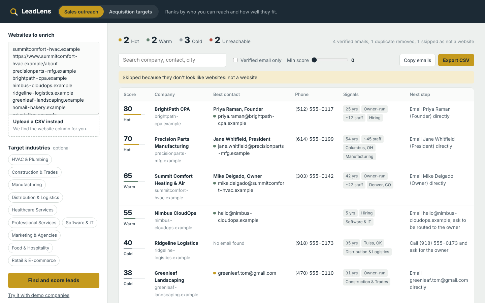
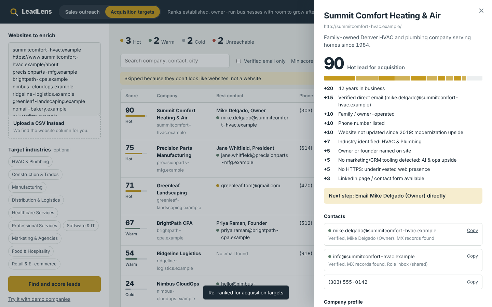
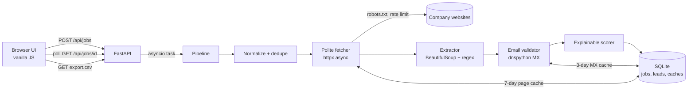

# LeadLens

**Turn a raw list of company websites into verified, ranked, CRM-ready leads, with the reason behind every score.**

Built for the Caprae Capital Full Stack Developer challenge as an enhancement to [SaaSquatch Leads](https://www.saasquatchleads.com/).



> 🌐 Live demo: https://leadlens-chi.vercel.app/

---

## The problem

Lead tools are good at producing *lists*. The expensive part comes after: a rep (or a search-fund operator) opens each website, hunts for the owner's email, guesses whether it works, removes duplicates from three spreadsheets, and decides who is worth a call. Most of that time goes to leads that were never going to convert.

Caprae uses lead data two ways: **selling** to businesses and **finding businesses to buy**. A good lead looks different in each case, but both need the same thing: fewer, better leads with a clear next step.

## What LeadLens does

Paste websites (or upload a CSV export from any CRM or scraper) and in seconds you get:

| Step | What happens | Why it matters |
|---|---|---|
| **Clean** | Normalizes URLs, emails and domains; removes duplicates (including two URLs that redirect to the same site); flags rows that aren't websites | No double-calling the same company from three lists |
| **Enrich** | Reads the homepage plus the most useful internal pages (contact, about, team) and extracts emails (incl. `name [at] domain [dot] com`), phones, socials, location, founding year, team size, owner names and titles, tech stack, hiring signals | The data a rep actually needs, not just a URL |
| **Validate** | Checks email syntax, disposable providers and MX records (can the domain receive mail?) and labels each address *Verified / Risky / Invalid* | Protects sender reputation; no SMTP probing |
| **Score** | 0–100 score with a tier (Hot / Warm / Cold) and an itemized list of reasons, under two lenses: **Sales outreach** and **Acquisition targets** | Reps work the top of the list first and can trust the ranking |
| **Act** | A concrete next step per lead ("Email Mike Delgado (Owner) directly"), filters, one-click copy, and CSV export with HubSpot/Salesforce-style column names | Drops straight into the existing sales workflow |

Switching the lens or target industries **re-ranks instantly without re-scraping**, so the same list can be used by the sales team and the deal team.



## Quick start

```bash
git clone https://github.com/saksheesachan003/leadlens.git && cd leadlens
python -m venv .venv && source .venv/bin/activate      # Windows: .venv\Scripts\activate
pip install -r requirements-dev.txt
uvicorn app.main:app --reload
```

Open http://localhost:8000 and click **Try it with demo companies**, or upload `sample_data/sample_leads.csv`.

The demo companies are fictional sites on the reserved `.example` domain, served by a built-in fixture. They work with no internet connection and cover the edge cases: a duplicate, an obfuscated email, a domain that can't receive mail, a site that blocks bots in robots.txt, a dead site, and an input that isn't a website. Any real domain you enter is fetched from the live web.

Run the tests:

```bash
pytest -q        # 15 tests: extraction, scoring, and full API flow
```

With Docker:

```bash
docker build -t leadlens . && docker run -p 8000:8000 leadlens
```

## Architecture



### Stack and decisions

| Layer | Choice | Why |
|---|---|---|
| **Backend** | Python 3.12, FastAPI, Uvicorn | Async I/O suits a scraper that mostly waits on the network; automatic OpenAPI docs at `/docs` |
| **HTTP client** | httpx (async, streaming) | Bounded concurrency (8 sites at once), 0.5 s delay between pages of the same site, 1.5 MB page cap, redirect handling |
| **Parsing** | BeautifulSoup + targeted regex | Fast and dependency-light; handles messy HTML |
| **Email validation** | dnspython (MX, falling back to A record per RFC 5321) | Real deliverability signal without sending mail |
| **Database** | **SQLite** in WAL mode | Zero setup and one file. Tables: `jobs`, `leads`, `site_cache`, `mx_cache`. The schema moves to Postgres unchanged when needed |
| **Caching** | Page cache (7 days) and MX cache (3 days) in SQLite; per-domain locks prevent duplicate DNS lookups | Re-running a list is instant; re-scoring never re-fetches |
| **Frontend** | Static HTML/CSS/vanilla JS served by FastAPI | No build step and nothing to deploy separately; the whole app is one container |
| **Hosting** | Docker container on **Render** (`render.yaml` blueprint), long-running web service rather than serverless | Background scraping jobs outlive the request, which serverless functions cut off |
| **CI** | GitHub Actions runs the test suite on every push | |

**Deployment:** push to GitHub → Render → *New Blueprint* → select the repo. Render builds the Dockerfile and health-checks `/api/health`. The same image runs unchanged on Google Cloud Run (with CPU always allocated) or AWS App Runner.

### Scaling path

The 5-hour version runs jobs as in-process async tasks, which is fine for lists of up to 200 sites. To scale:

1. Move jobs to a queue (Redis + RQ/Celery, or Cloud Tasks) with several workers.
2. Swap SQLite for Postgres (same schema) and put the page cache in Redis or object storage.
3. Add a rotating proxy pool and a headless-browser fallback (Playwright) for JavaScript-only sites.

## Scoring model

Every point is tied to a sentence the user can read. No black box.

**Sales outreach** (who can we reach, and do they fit?)
- Reachability, up to 45: verified direct email 25, shared inbox 15, unverified 8; phone 10; LinkedIn / contact form 10
- Fit, up to 35: target industry 20; hiring 5; team size known 5; location known 5
- Activity, up to 20: HTTPS 5; clear description 5; site updated this year 10

**Acquisition targets** (established, owner-run, with upside after a buy; built for Caprae's ETA thesis)
- Established and owner-run, up to 50: years in business (20+ yrs = 20); family/owner-operated 10; owner named 5; target industry 15
- Reachability, up to 30: direct email 15; phone 10; LinkedIn / form 5
- Modernization upside, up to 20: site not updated in 3+ years 10; no marketing/CRM tooling 5; no HTTPS 5

Tiers: **Hot** 70+, **Warm** 45–69, **Cold** below 45. Unreachable sites are kept in view (so the user knows they were checked) but excluded from exports.

## Responsible collection

- Reads only public pages and follows `robots.txt`
- Identifies itself with a clear User-Agent
- Rate-limited per site and capped in concurrency
- Never sends email or probes mail servers to verify addresses
- Doesn't attempt to bypass CAPTCHAs or logins

## API

Interactive docs at `/docs`.

| Method | Path | Purpose |
|---|---|---|
| `POST` | `/api/jobs` | `{text, lens, industries}` → start a job |
| `POST` | `/api/jobs/upload` | multipart CSV upload (finds the website column automatically) |
| `GET` | `/api/jobs/{id}` | progress and scored leads |
| `POST` | `/api/jobs/{id}/rescore` | change lens or industries without re-scraping |
| `GET` | `/api/jobs/{id}/export.csv` | filtered export (`tier`, `min_score`, `verified_only`, `q`) |

## Project layout

```
app/
  main.py         API routes, CSV export
  pipeline.py     job orchestration, input parsing, dedupe
  scraper.py      polite async fetcher, robots.txt, link ranking
  extract.py      contacts, company profile, business signals
  validate.py     email syntax, provider and MX checks
  scoring.py      two-lens explainable scoring, next action
  db.py           SQLite schema and caches
  demo_sites.py   offline fictional demo companies (.example)
static/           UI (HTML, CSS, JS)
tests/            pytest suite
sample_data/      example CSV input
```

## Known limitations

- Sites that render all content with JavaScript return little text; a Playwright fallback is the next step.
- Industry classification is keyword-based. An LLM classifier would be more accurate for edge cases.
- MX checks confirm a domain can receive mail, not that a specific mailbox exists.

## What I'd build next

1. **LLM summary per lead**: a two-line "why reach out now" and a first-line email opener drafted from the site content.
2. **Direct CRM push** to HubSpot and Salesforce via their APIs instead of CSV.
3. **Scheduled re-checks** that alert when a Hot lead changes (new hire posting, site relaunch, ownership change).
4. **Feedback loop**: reps mark leads as converted or not, and the scoring weights are tuned from real outcomes.
